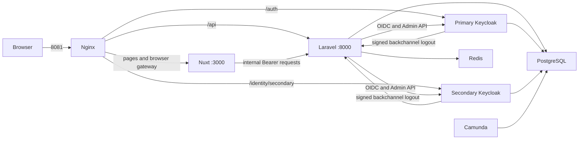

# Phase 1 architecture and business behavior

> Historical Phase 1 baseline. Current Organization/Personnel/Access and user-location/appearance changes are documented in [Phase 2](organization-personnel-access.md). Its additions supersede the former Login-only scope below. [Phase 3](personnel-account-connections.md) adds local personnel creation, per-source membership uniqueness, account management and member-specific token revocation.

## Scope and repository

This phase provides Docker development infrastructure and the Login module of an organizational monorepo. Keycloak owns credentials and identity lifecycle. Laravel stores local users, imported memberships, source configuration and revocable Sanctum credentials. Nuxt provides SSR and the browser credential gateway.

| Path | Responsibility |
| --- | --- |
| `backend/app/Modules/Login/` | Models, actions, OIDC services, routes, requests, resources, commands, migrations and provider |
| `backend/tests/Feature/Login/` | Login integration tests against an isolated PostgreSQL database |
| `frontend/app/` | Vuetify RTL UI, local CSS, source dialog, SSR plugin and login state |
| `frontend/server/` | Browser gateway, encrypted cookies, callbacks and logout handoff |
| `frontend/public/` | Local Vazirmatn font and logout assets |
| `infra/` | Docker images, Nginx, service configuration and database initialization |
| `scripts/` | Bootstrap, identity reconciliation and acceptance checks |

The composition root registers `LoginServiceProvider`, which loads module routes, commands, migrations and the custom Sanctum token model. Infrastructure readiness remains outside the business module at `GET /api/health`. No user-management UI, roles/permission module, automatic account linking or business workflow module is included. Camunda is running and tested as infrastructure.

## Runtime baseline

Dependency lockfiles and image declarations are authoritative. The reviewed baseline uses Laravel 13.39.0, Sanctum 4.3.3, PHP 8.4.21, Composer 2.10.3, Nuxt 4.6.3, Vue 3.5.44, Vuetify 3.13.7 and Node 24.22.1. Service images are PostgreSQL 17.6, Redis 8.2.2, Keycloak 26.7.3, Camunda 8.9.27, Nginx 1.28.0 and pgAdmin 9.10.

PHP/Node/Keycloak image declarations include digests. Other service tags and dependency lockfiles pin the reviewed versions. Updating a dependency is separate work; starting development installs the locked dependency set.

## Network and persistence

Only Nginx publishes host ports, bound to `127.0.0.1`.

| Host entry point | Internal destination | Purpose |
| --- | --- | --- |
| `http://localhost:8081/` | `frontend:3000` | Nuxt pages, `/gateway/login/*`, `/login/*` |
| `http://localhost:8081/api/*` | `backend:8000` | Laravel API |
| `http://localhost:8081/auth/*` | `keycloak:8080` | Primary public identity flow; admin subtree is blocked |
| `http://localhost:8081/identity/secondary/*` | `keycloak-secondary:8080` | Independent secondary identity flow; admin subtree is blocked |
| `http://localhost:8082/` | `pgadmin:80` | Database management |
| `http://localhost:8083/auth/admin/` | `keycloak:8080` | Primary Keycloak administration |
| `http://localhost:8083/identity/secondary/admin/` | `keycloak-secondary:8080` | Secondary Keycloak administration |
| `http://localhost:8084/` | `camunda:8080` | Process management, initially `/operate` |

Laravel runs `php artisan serve --host=0.0.0.0 --port=8000 --no-reload`; Nuxt runs `npm run dev` on `0.0.0.0:3000`. Source files are bind-mounted for development. `WATCH_POLLING=true` enables frontend polling where filesystem events are unreliable. These internal runtime ports, PostgreSQL, Redis and process-engine ports are not published directly.

Services share the Compose `application` bridge and use service DNS names. PostgreSQL has separate roles/databases for `organization_app`, `keycloak`, `keycloak_secondary` and `camunda`, with public database access revoked. `organization_test` belongs to the application role for isolated tests. No schema owned by Keycloak or Camunda is managed by Laravel migrations.

Persistent volumes hold PostgreSQL, Redis AOF, pgAdmin and Camunda data. Separate volumes hold installed backend/frontend dependencies. Initialization services prepare dependencies, apply Laravel migrations, fix Camunda volume ownership and create the secondary identity database idempotently. `scripts/bootstrap.py` preserves existing secrets and renders private, ignored `.runtime/` files; `scripts/configure-identity.py` reconciles the application's own clients without resetting realms.

## Identity and import policy

UserSource has a unique immutable `slug` for public identifiers, URLs, commands and callback binding. Member stores numeric `user_source_id`, referencing `user_sources.id`; `(uuid, user_source_id)` is unique. `uuid` is the provider subject as an opaque string. The same subject in two sources can identify different local users.

A local User may have several Members only through explicit operator mapping. Names/emails never trigger a merge. Import uses a separate `organization-import` client with service-account `view-users`/`query-users` permissions. Enabled human accounts are imported; disabled accounts and `service-account-*` usernames are skipped. New identities create one User/Member transactionally; existing memberships retain their User and local name. Read-only pages retry up to three times for connection/server/rate-limit failures. A failed import stops without removing existing records or rolling back already completed member imports.

Login does not auto-register. A valid provider identity without an imported Member receives `403 member_not_imported`. The module has no local password or password-reset lifecycle.

## Login and SSR

1. The Login button opens a source-selection dialog containing active sources.
2. Nuxt validates Origin and CSRF proof and creates a protected browser-binding cookie. Laravel stores a five-minute source/config/binding-bound OIDC transaction with state, nonce and PKCE S256 verifier in Redis.
3. The selected Keycloak authenticates the user on the application's `8081` origin.
4. Nuxt's `/login/callback/{slug}` forwards the code, state and binding internally. Laravel consumes the transaction once, exchanges the code, verifies RS256 signature, issuer, audience/authorized party, nonce, expiry, subject and session ID, then finds the pre-imported membership by numeric source ID and verified subject.
5. Laravel persists a hashed Sanctum token and encrypted provider grant. Its initial expiry is at most 24 hours, bounded by positive provider `refresh_expires_in`; absent/zero refresh expiry uses the 24-hour cap. Refreshing the upstream token does not extend local token expiry.
6. Nuxt puts the Sanctum credential in an AES-256-GCM encrypted HttpOnly, SameSite=Lax cookie and redirects to `/`. Secure is enabled for HTTPS; local HTTP development is the explicit exception.

The asynchronous Nuxt server plugin resolves identity before rendering HTML and forwards cookie updates to the browser response. Only sanitized user/source/member display data, CSRF proof and UI status are serialized. Bearer credentials and upstream access/refresh tokens never enter browser JavaScript, browser storage, URLs or the SSR payload. The browser may see an ID-token hint only in the constrained RP logout POST form.

Laravel uses Sanctum API-token authentication without a `web`/session guard fallback or stateful SPA middleware. Sanctum token persistence and short-lived OIDC transactions remain server-side state; there is no server-side browser login session. Authenticated HTML and gateway responses use `no-store`.

## Grant validity and logout

Every protected `/me` request verifies active source/membership/configuration and introspects the upstream grant without a positive validity cache. Access tokens expiring within 15 seconds are refreshed under a per-grant Redis lock (180-second lease, up to five seconds waiting). JWKS are cached for five minutes and refreshed once after decoding failure; this is key caching, not cached login validity.

Invalid/revoked grants return 401 and revoke the application credential. Provider outages return 503 from Laravel and preserve the credential. Nuxt represents that as `unavailable`; its initial page has HTTP 503 and no anonymous login flash. The browser gateway identity endpoint returns its status object with HTTP 200 so the UI can render the unavailable state. An upstream 401 due to client authentication is treated as configuration failure/503.

Application logout revokes the local token without first requiring a successful upstream check. A 120-second encrypted single-use Redis handoff carries a bound RP logout POST to the originating Keycloak; the local credential cookie is removed. A protected return state verifies `/login/logged-out`. Failed/unverified remote completion is not reported as confirmed success.

Backchannel logout verifies signature, issuer, audience, recent issue time, event object, absence of nonce and session/subject claims. A source/config-scoped `jti` replay marker lasts ten minutes. Matching grants are deleted only for that source and session/subject. Repeated valid events are harmless. Missed notifications are detected by the next upstream validity check. Visible pages recheck every 15 seconds and on focus/visibility; visual updates also depend on request latency.

The development client reconciler enables PKCE, the fixed callbacks/post-logout target, backchannel delivery, the `basic` subject scope and an access-token audience mapper for `organization-backend`. Camunda keeps its separate primary-provider client, `organization-process`, and management callback on 8084.

## Frontend conventions

Vuetify supplies the RTL controls and theme system. Vazirmatn, SVG icon paths, fonts, CSS and handoff JavaScript are local assets. Custom styles live in dedicated CSS files; project Vue components contain no style blocks, inline styles or style bindings. Light, dark and automatic modes are available; automatic mode reacts to device theme changes while open. The restrained palette, readable typography and focus states support long working sessions.

## Related contracts

[Database changes](database.md), [API contracts](login-api.md), and [verification evidence](validation.md) describe the other parts of the approved phase. No unrelated business database/API changes were introduced.
