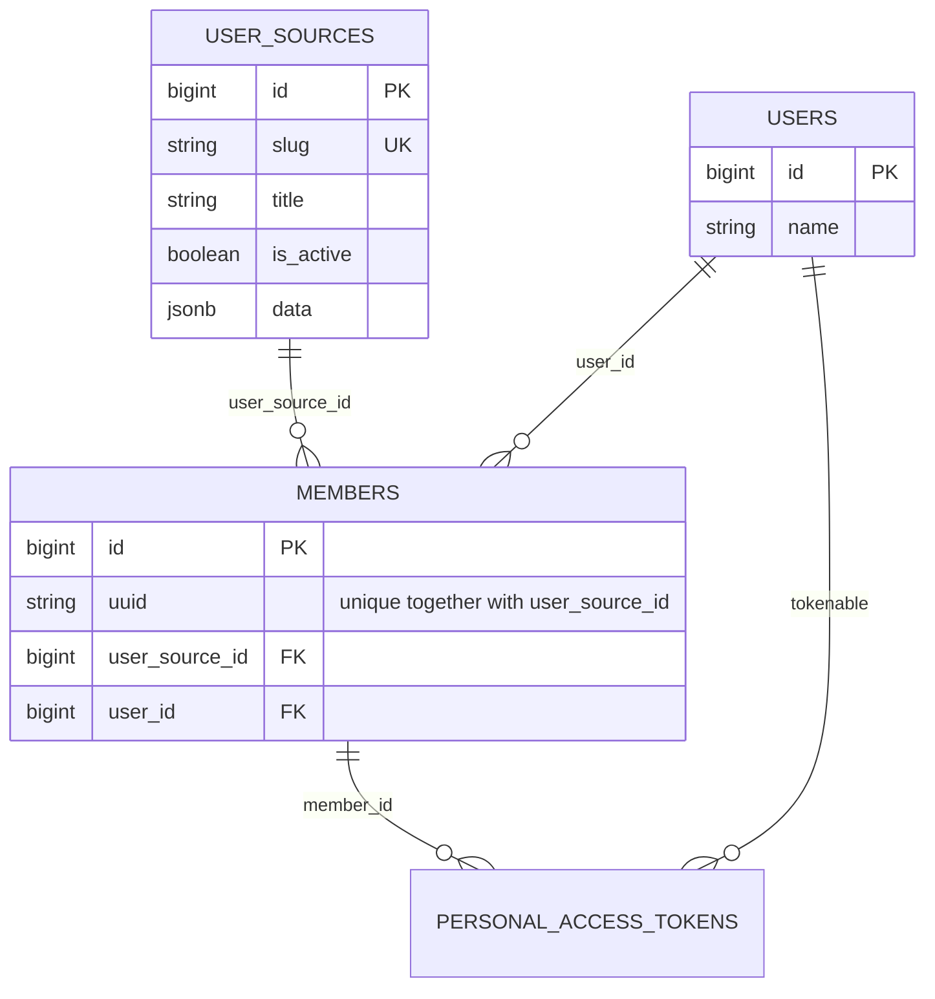

# Phase 1 database design and changes

## Ownership

Laravel owns `organization_app`. Keycloak primary/secondary and Camunda own their separate databases and migrations. Redis is used for cache, throttling and bounded protocol/lock records, not Laravel browser sessions. This phase introduces the Login domain and Sanctum storage; no tables for another business module, local passwords or password resets are introduced.

## Final application schema

Every table below has Laravel `created_at` and `updated_at` timestamps.

| Table | Columns and constraints |
| --- | --- |
| `user_sources` | `id` bigint primary key; `slug` varchar(63), unique/not null; `title` varchar(255), not null; `is_active` boolean, default false/not null; `data` JSONB, not null |
| `users` | `id` bigint primary key; `name` varchar(255), not null |
| `members` | `id` bigint primary key; `uuid` varchar(255), not null; `user_source_id` bigint, not null, FK to `user_sources.id`; `user_id` bigint, not null, FK to `users.id`; UNIQUE (`uuid`, `user_source_id`); index on `user_source_id` |
| `personal_access_tokens` | `id` bigint primary key; indexed `tokenable_type`/`tokenable_id` morph; `name` varchar(255); unique `token` varchar(64); nullable `abilities` text, `last_used_at`, `expires_at`; expiry index; required `member_id` FK; nullable `provider_sid` varchar(255); required `provider_config_hash` varchar(64); required `oidc_data` text; index (`member_id`, `provider_sid`) |

Domain foreign keys restrict deletion. The numeric source FK also restricts source-ID updates. No source slug column remains in `members` after all migrations. The UserSource model keeps `slug` immutable and URL-safe using `[a-z0-9]+(-[a-z0-9]+)*`; source public responses hide the internal ID.



Sanctum's polymorphic owner has no SQL FK to users; the Login flow creates User-owned grants and validity middleware checks that the token owner matches `member.user_id`.

## Identity invariants

- `(uuid, user_source_id)` identifies one provider membership. UUID is an opaque string, supporting federated subject formats.
- One User can have several memberships; an explicit import mapping is required to associate a new provider subject with an existing User.
- The same subject in a different source is allowed. Matching names/emails do not merge users.
- Callback lookup uses the verified subject and selected source's internal ID. It cannot create a missing membership.
- Credentials reference Member by its stable primary key; the source relationship correction preserves these references.

## Source configuration and encryption

`user_sources.data` contains operator-supplied provider settings. Required fields are `issuer`, `internal_issuer`, `client_id`, `client_secret`, `callback_url`, `post_logout_redirect_uri`, `allowed_algorithms` (only `RS256`), `timeout` (1–30 seconds) and `page_size` (1–500). Optional import configuration consists of `import_client_id`, its required `import_client_secret`, and required `admin_base_url`.

Callbacks must equal `APP_URL/login/callback/{slug}`; logout return must equal `APP_URL/login/logged-out`. Provider URLs may not contain credentials, queries or fragments; production provider URLs require HTTPS. OIDC/JWKS/token URLs are built from trusted source configuration, not browser parameters or unverified JWT claims.

`client_secret` and `import_client_secret` are encrypted individually with Laravel encryption before storing JSONB. The whole object is not stored through an encrypted-array cast. The source `data` and internal ID are hidden from default serialization.

`personal_access_tokens.token` stores the SHA-256 hash of the Sanctum secret. `oidc_data` uses an encrypted-array cast over a TEXT column and contains access/refresh/ID tokens plus access expiry. Its value, token hash and provider fingerprint are hidden from default serialization. The auth configuration fingerprint includes the source slug and relevant issuer/client/callback/algorithm settings. A changed fingerprint or disabled source invalidates outstanding grants; it cannot silently bind them to another provider.

## Migration history

| Migration | Effect |
| --- | --- |
| `2026_11_03_000001_create_login_tables.php` | Creates source, user, membership and extended Sanctum tables. The historical initial Member relationship used `user_source_slug`. |
| `2026_11_04_121157_use_user_source_id_in_members.php` | Adds nullable numeric source ID, backfills by joining the old slug to `user_sources.slug`, enforces NOT NULL and restrictive FK, creates UNIQUE (`uuid`, `user_source_id`) plus source index, then drops the old slug FK/unique/column. |

The original applied migration is retained. Fresh installations run both migrations and finish with the same final schema as an existing installation. PostgreSQL migration transactions protect the upgrade: an unmapped source cannot pass NOT NULL and leaves the prior schema/data intact if the migration fails.

The second migration's `down()` performs the reverse backfill and restores the original slug relationship. Rollback must be coordinated with the corresponding code version, because the current application expects `user_source_id`. Rollback/upgrade round-trips were exercised only on isolated test data; the live development upgrade did not reset tables or volumes.

Private before/after snapshots confirmed unchanged Member IDs, UUIDs, User/source associations and token foreign keys. Temporary snapshots were removed. Existing imported development members were retained and re-import created zero new members for both sources.

## Upgrade and test operations

Run from the repository root:

```bash
docker compose exec -T backend php artisan migrate --force --no-interaction
docker compose exec -T postgres psql -U postgres -d postgres -v ON_ERROR_STOP=1 < scripts/prepare-test-database.sql
docker compose exec -T backend php artisan test --compact
```

`./scripts/dev up` also applies migrations through `backend-init`. Tests force `organization_test`, and the test base refuses a database name that does not end with `_test`. Do not run `migrate:fresh` against application/provider data. See the [Persian operations guide](../guides/development.fa.md) for normal startup/import commands.

Business behavior and API changes are documented in [architecture](architecture.md) and [Login API](login-api.md). There are no additional business-schema changes outside Login in this phase.
